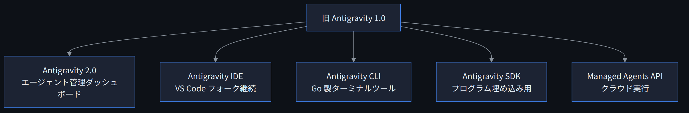
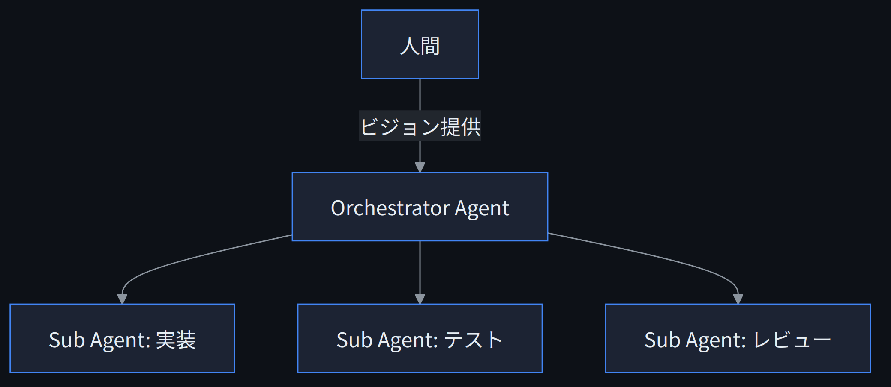
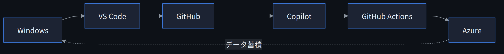
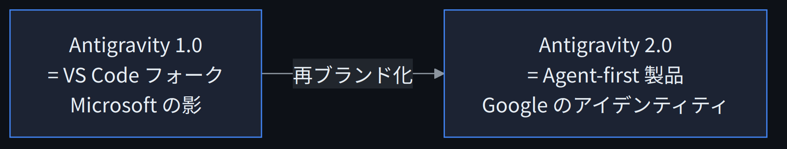
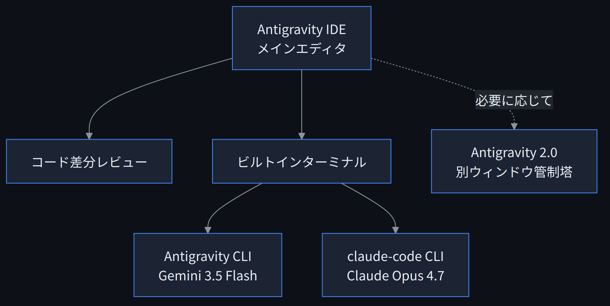
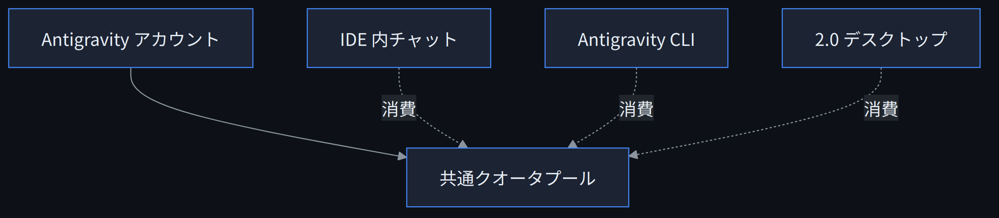
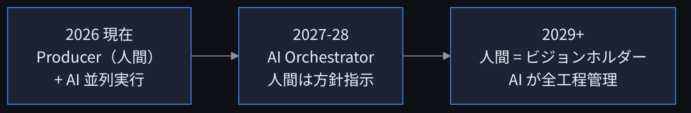

2026年5月19日、Google Antigravity のアップデート通知が世界中の開発者のパソコンに届きました。いつも通り「更新」ボタンを押して、アプリが立ち上がる瞬間に、多くの人が固まりました。

**「コードエディタが、消えている。」**

「俺の Antigravity IDE どこいった？」「アンインストールされた？」と、Reddit や X で同じ叫びが響きました。僕もその一人です笑

最初は「Google のマーケティングミス」だと思いました。でも、公式ブログを精読して、Big Tech の戦略を分析した結果、見方は180度変わりました。

**これはミスではなく、Google が周到に設計した戦闘**だったのです。しかも単に「IDE 市場を奪う」表面的な話ではなく、Microsoft・Apple・Google の三つ巴の中で **「Microsoft の城に侵攻するふりをしながら、未来の城を先に建てる」** という三手先の戦略でした ჱ̒⸝⸝•̀֊•́⸝⸝)✨

--- 
## 目次

- 【第1章】あの日アップデートで何が変わったのか
- 【第2章】Windows と Mac で全く違う “アップデート後の現実”
- 【第3章】Gemini 3.5 Flash というモンスター
- 【第4章】Google 公式が “こっそり” 告白していた本当の主役
- 【第5章】Big Tech “三つ巴” の代理戦争
- 【第6章】ブランド再ポジショニングの暴力性
- 【第7章】2026年5月のベスト選択
- 【終章】コードを書く時代の、その先へ
--- 


## 【第1章】あの日アップデートで何が変わったのか

Antigravity が **5つのサーフェス** に分裂しました。



多くの人が混乱した理由はシンプルです。**「Antigravity 2.0」は名前こそ2.0だが、旧 IDE の後継ではない**。Pragmatic Engineer の Gergely Orosz の表現を借りれば「Google が、最初の製品と名前を共有する**第2の製品**を出荷した」のです。

本来なら「Antigravity Manager」のような別ブランドにすべきでした。でも Google はあえて「2.0」と命名し、強制的に既存ユーザーへ配信した。**この命名と配信方法そのものが戦略の一部**だったというのが、僕の分析です。


## 【第2章】Windows と Mac で全く違う “アップデート後の現実”

ここが今回の騒動で見過ごされがちな重要ポイントです。**OS によってアップデートの挙動が全く違いました**。

### Windows：アプリの上書きハイジャック

まず前提として、Antigravity（VS Code や Cursor も同じ）は **Electron** という技術で作られています。ウェブの技術でデスクトップアプリを作る仕組みで、アプリの中核に `app.asar`（本体コードを1つに固めたファイル）を持ちます。アイコンを起動すると、実行ファイル（`.exe`）が**同じフォルダにある `app.asar` を読みに行く**——ここが今回のトラブルの鍵です。

そのうえで Windows では「アプリ本体」と「データ」で別々の問題が**同時に**起きました。

**① アプリ本体（`C:\Program Files\` 側）のハイジャック**

5/19 のアップデートで、インストーラーが旧 IDE と**同じディレクトリ**に 2.0 の `app.asar` を上書きしました。

```
C:\Program Files\Antigravity\
├── Antigravity.exe       ← 旧 IDE の実行ファイル（そのまま残る）
└── resources\
    └── app.asar          ← 中身が 2.0 に置き換わった！
```

実行ファイルは旧 IDE のものが残っているのに、それが読みに行く `app.asar` の中身が 2.0 に差し替わった。結果、**旧 IDE のアイコンを押しても 2.0 が立ち上がる**状態に。旧 IDE のファイルが消えたわけではなく、起動する手段が奪われたのです。これが「ハイジャック（乗っ取り）」です。

**② データ（`C:\Users\[USER NAME]\AppData\Roaming\` 側）の分裂**

設定やチャット履歴の保存場所でも、別の問題が起きました。

```
C:\Users\[USER NAME]\AppData\Roaming\
├── Antigravity\          ← 旧 IDE のデータ（履歴・設定・拡張機能）
└── Antigravity IDE\      ← 新アプリが読みに行く先（空っぽ）
```

今まで使ってきたデータは `Antigravity` フォルダに溜まっているのに、新アプリは `Antigravity IDE` フォルダを読みに行く。だから起動しても**履歴や設定が消えたように見える**。実際はデータは無事で、**読み込み先がズレただけ**です。

この2つが同時に起きたため、Windows ユーザーは「アプリも起動しない、データも消えた」と二重のパニックに陥りました笑

### Mac：並走インストール

`/Applications/` に新しい `Antigravity.app` がインストールされ、旧 `Antigravity IDE.app` は**そのまま並走**しました。ダブルクリックすれば旧 IDE もすぐ使える状態。

### なぜ違うのか？

技術的には Windows でも並走は可能です（Arduino IDE や Adobe CC は普通にやってる）。Google が**意図的に Windows ユーザーだけ強制移行**を選んだのです。

この理由は第5章で深掘りしますが、結論を先に言うと：**Windows ユーザーは Microsoft の最強の城の住人だから**。Google が最も奪い取りたいユーザー層だったのです。

### 復旧手順（Windows）

もし旧 IDE に戻したいなら：

1. Antigravity 2.0 をアンインストール
1. 公式ダウンロードページ最下部から Antigravity IDE 単体版をダウンロード
1. `%APPDATA%\Roaming\Antigravity` のデータを `%APPDATA%\Roaming\Antigravity IDE` にコピー

Mac はアプリケーションフォルダの `Antigravity IDE.app` をダブルクリックするだけ笑


## 【第3章】Gemini 3.5 Flash というモンスター

同日発表された Gemini 3.5 Flash の数字を整理します。

|指標                |数値                          |
|------------------|----------------------------|
|Terminal-Bench 2.1|76.2%（3.1 Pro 超え）           |
|出力速度              |280+ tokens/秒（他社の4倍速）       |
|MCP Atlas         |83.6%（Claude・GPT 含む全モデルでトップ）|
|価格                |$1.50 / $9 per 1M トークン      |

Pichai 発言：「フロンティアモデルの約90% の性能、4倍速、**Antigravity では恐らく12倍速**、コストは1/3〜1/2」。

12倍速の内訳は「モデル単体4倍 × Antigravity ハーネス最適化3倍」。さらに **thought preservation がデフォルト ON** で、ターン間の推論コンテキストが引き継がれます。

ただし注意点。Artificial Analysis 検証では **ベンチマーク実行コストは 3 Flash の5.5倍**。「速くて賢くなった分、放置すると数分でトークンが消し飛ぶ」リスクが現実にあります。

Pichai は社内データも明かしました：「Antigravity 2.0 のトークン消費は3月の0.5兆/日 → 5月中旬3兆超/日。**数週間ごとに倍増している**」。Google 自身が大規模にエージェントを走らせているからこそ、外向け製品も「エージェント指揮」前提に切り替えたのです。


## 【第4章】Google 公式が “こっそり” 告白していた本当の主役

ここから記事の核心です。Google 公式ブログ（blog.google）の I/O 2026 コレクションページに、本当の意図が書かれています。

### 公式メッセージ4選

> **①** 「私たちは**書くことを助けるAIツールを超えて、行動を助けるエージェント**へと移行した。**今や誰もがビルダーになれる**」
> 
> **②** Pichai の I/O 2026 オープニング記事タイトル：「**Welcome to the agentic Gemini era**」
> 
> **③** Gemini 3.5 公式ポジショニング：「**frontier intelligence with action**」「複雑なエージェントワークフローを実行するために構築された」
> 
> **④** スローガン：「**now anyone can be a builder**」

「write を助ける AI tool」から「act を助ける agents」への明確な対比。**エージェントは “支援するもの” ではなく “代わりに行動するもの”** という設計思想です。

### 本当の主役：Orchestrator Agent

公式メッセージを統合すると、Antigravity 2.0 の主役が見えます。

主役は、「Producer（人間）」ではなく 「**Orchestrator Agent（指揮エージェント）**」です。



MindStudio の分析：「スタックの頂点には**単一のオーケストレーターエージェント**が座る。彼の仕事は、コードを書くことではなく、問題を分解し、サブタスクを割り当て、依存関係を管理し、進捗を追跡し、出力をマージすること。**一行も書かないが、システムを常に把握しているテックリードのような存在**」です。

つまり、これまでProducer（人間） がやってきた仕事を、**指揮エージェント自身に置き換える**設計です。

### 「分かる人にだけ分かれ」というフィルタリング

「これだけ重要なビジョンなら、なぜ分かりやすく伝えないのか？」

僕の読み：**Google はあえて分かりにくく伝えている**。そう考える証拠が4つあります。

- **強制アップデート**：ユーザーが「更新する／しない」を選べず、起動すると勝手に 2.0 へ切り替わった。本当に IDE を残したいなら、任意アップデートにすればよかったはず。
- **30日デッドライン**：旧バージョンの一部機能（Gemini CLI など）が「6月18日で終了」と短い猶予で告知された。じっくり検討させず、移行を急がせる設計です。
- **IDE 隠し**：第2章で見た通り、アップデート後はコードエディタが表に出てこず、チャット画面だけが立ち上がる。「コードを書く時代は終わり」というメッセージを体で分からせる作りです。
- **Varun Mohan（Google DeepMind のソフトウェア部門責任者）の事後発言**：批判を受けて「もっとクリアにすべきだった」と認めたものの、**設計そのものは元に戻さなかった**。つまり「伝え方は荒かったが、方向性は正しい」という本音が透けています。

公式ブログには全部書いてあるんです。ただし、能動的に AI で調査して読み解く人にだけ伝わる設計。これは苫米地理論で言う **「Want-to（自発的）と Have-to（やらされ）の選別装置」** として機能しています👍


## 【第5章】Big Tech “三つ巴” の代理戦争

ここから最も深い層に入ります。Antigravity 騒動は単なるアプリ更新ではなく、**Microsoft・Apple・Google 三つ巴の代理戦争**でした。

### Microsoft フライホイール

「フライホイール（弾み車）」とは、**一度回り始めると各要素が次の要素を後押しして、勝手に勢いが加速していく仕組み**のこと。自転車も漕ぎ出しは重いけど、スピードに乗れば軽い力で進み続けますよね。ビジネスでも、製品同士が連携して「1つ使うと隣も使いたくなる」状態を作れれば、成長が雪だるま式に加速し、競合は追いつけなくなります。

まず、開発者の世界で Microsoft が支配している領域を見てみましょう。

|製品            |状況                     |
|--------------|-----------------------|
|GitHub        |世界1億人、Fortune 100 の 90%|
|VS Code       |開発者シェア 70%+            |
|Windows       |開発者 OS シェア 47-59%      |
|GitHub Copilot|AI コード補完の事実上の標準        |
|Azure         |エンタープライズの巨大顧客基盤        |

そして決定的なのが、これらが**フライホイールとして連動**していること。開発者が1日の作業で触る道具——OS、エディタ、コード保存、AI補完、デプロイ先——が、すべて Microsoft 製品で繋がっているのです。



Microsoft の巧妙さは「Azure 使え」と強制しないこと。代わりに GitHub の新機能が Azure ベースで作られていて、**「便利だから」と使ううちに自然に Azure 依存になる**構造。

InfoWorld の Matt Asay：「開発者が Antigravity に “切り替える” 時でも、**Microsoft の家の中で別の部屋に移っているだけ**」。

### フライホイールは Microsoft だけの戦略じゃない

ちなみに僕（あずま）の場合、個人ユーザーであること、そして Antigravity を使う前から Gemini を愛用していたので、**最初から Microsoft のフライホイールには乗っていませんでした**。だから今回のアップデートも「Microsoft の城から引き剥がされる痛み」を感じずに済んだ——これはたまたま運が良かっただけです笑

そして重要なのは、**このフライホイール戦略は Microsoft の専売特許ではない**ということ。現代のフリーミアム（基本無料・高度な機能は有料）の時代、Big Tech はどこも同じ手を使っています。

- **Apple**：iPhone・Mac・iPad・Apple Watch がシームレスに連携し、iCloud・Apple Music・Apple TV+ のサブスクで囲い込む。一度 Apple 製品で揃えると、他社に移ると連携が崩れるので抜けにくい。
- **Amazon**：Prime（送料無料・動画・音楽）で顧客を惹きつけ、AWS（クラウド）で企業を技術依存させる。「安く・速く・便利」のループが回るほど競合を引き離す。
- **Google**：検索・Gmail・Chrome・Android・YouTube で日常を押さえ、その上に Gemini・Firebase・Google Cloud という開発者フライホイールを新しく載せようとしている。**今回の Antigravity は、まさにこの新しい輪の入り口**です。

つまり Antigravity 騒動は「Microsoft の輪に乗っていた開発者を、Google の輪へ引っ張り込む」という、**フライホイール同士の奪い合い**として見ると本質が掴めます。

### Windows のフライホイールに乗っているのは「個人」より「大企業」

ここで OS シェアの話と繋げると、面白い構造が見えてきます。

開発者の OS シェアは、海外で Windows 47-59% / macOS 32%、日本全体では Windows 71% / macOS 13% でした。一見「Windows ユーザーが多数派」に見えます。

でも中身を分けると、**Windows のフライホイールにガッチリ乗っているのは、個人開発者よりも大企業・SIer（受託開発会社）**です。理由はシンプルで、大企業ほど Microsoft 製品で固められているから：

- 社内システムが Windows Server・.NET・Excel 前提で作られている
- セキュリティポリシーが Azure / Microsoft 365 ベース
- チーム全体が GitHub Enterprise + Azure DevOps で統一されている

日本では特にこの傾向が強く、**大手 SIer・銀行系・公共系の開発現場は Windows 比率 95% 以上**。一方で、Web 系・スタートアップの開発者は日本でも macOS 60-70% と、むしろ Mac が主流です。

この構図は海外、特にシリコンバレーではさらに極端になります。スタートアップやテック企業では **入社時に支給されるのが当たり前のように MacBook**で、クラウドも AWS や Google Cloud を選ぶのが定番。Microsoft 製品（Windows・Azure・.NET）はむしろ「お堅い大企業の道具」というイメージで、スピード重視のスタートアップ文化からは敬遠されがちです。逆に、フォーチュン500に名を連ねるような巨大企業・金融・行政は、世界的に見ても Microsoft のフライホイールでガッチリ固められています。

つまり日本でも海外でも、**個人開発者やスタートアップは Mac + Google/AWS 寄りで身軽、大企業は Windows + Microsoft でガッチリ固定**という同じ二層構造になっているわけです。

ここから一つの本質が見えてきます。「Windows ユーザー」と一括りにしても、**個人開発者（あずまのような層）はフライホイールに緩くしか乗っていない**のに対し、**大企業の開発者は輪の中心でガッチリ固定されている**。そして大企業ほど一人あたりのクラウド支出が大きく、チーム単位・全社単位でツールを採用します。

Google が Windows ユーザーへ強行突入したのは、この **「大企業という最大の獲物」を Microsoft から引き剥がしたいから**。個人を1人取り込むより、大企業を1社まるごと Google エコシステムへ動かすほうが、桁違いに大きい。そう考えると、あの強引な手口の意味がさらに腑に落ちます👍

### Apple の絶妙な中立ポジション

Apple は実はこの戦争では中立です。macOS は開発者シェア32%、Xcode は iOS 開発で必須、自社では AI IDE を作っていない。**戦闘から距離を置きつつ、両陣営から金を取るスイス的ポジション**。

Mac ユーザーは Microsoft / Google どちらにとっても「中立地帯の住人」。だから Antigravity 2.0 のアップデートも丁寧に扱われた（並走インストール）のです。

### 開発者 OS シェアの地域差

**海外**：Windows 47-59% / macOS 32% / Linux 27%
**日本全体**：Windows 71% / macOS 13%
**日本 Web系・AI開発**：macOS 60-70% / Windows 30-40%

開発者市場全体では Windows ユーザーが最多。Google はここに楔を打ち込みたかった。

### なぜ Windows ユーザーだけ強制移行か

第2章の謎の答えです。**Windows ユーザー = Microsoft 城の住人**。Mac ユーザー = 中立地帯。

行動経済学の「現状維持バイアス」を逆手に取る戦術：

- Mac ユーザーは変化に積極的 → 強制すると反発
- Windows ユーザーは現状維持的 → 強制移行されると、新しい現状に適応する

つまり Google は **Windows ユーザーの現状維持バイアスを逆手に取って、新しい “現状” を作った**。一度 Antigravity 2.0 が常駐したら、それを新しい現状として受け入れる確率が高い。

これは戦闘における **「敵地への強行突入」**。Mac には丁寧に、Windows には強引に。同じ製品でも戦場が違うから戦術が違うのです。

あなたが Windows ユーザーで Antigravity の更新で混乱したなら、**それは Google にとって “成功した強行突入”** でした笑


## 【第6章】ブランド再ポジショニングの暴力性

ここまでの分析を踏まえて、**Google が IDE を剥がした本当の理由**に進みます。

### Antigravity が抱えていた「アイデンティティ問題」

2025年11月の Antigravity 1.0 リリース時点で、開発者の認識は：

- 「これは VS Code 派生物」
- 「Microsoft の城の別の部屋」
- 「Google のアイデンティティが薄い」

Hacker News の議論：「**フラグメンテーションは全部 Microsoft を助けるだけ**」。

つまり Antigravity が「VS Code フォーク」として認識されている限り、**Microsoft の城を間接的に強化しているだけ**になる。

### 2.0 で打った手



これは **ブランド再ポジショニング** — マーケティングの教科書に出てくる最も難しい戦術の一つ。Google は強制アップデートと IDE 隠しで、これを暴力的に実行しました。

### 「混乱」自体が戦略の一部

あの日の世界中の混乱は、副作用ではなく**戦略の一部**でした：

1. 混乱発生 → 「IDE どこ？」と困惑
1. 議論発生 → 「Antigravity って Google 製品やったんや」と意識化
1. 再認識 → 「これは VS Code じゃない、Google の Agent プラットフォーム」
1. 強制学習 → 「Antigravity = Agent-first = Google」が脳に刻まれる

苫米地理論で言えば **RAS（網様体賦活系）の重要性関数の書き換え**。「Google = 検索」だった人の脳に「Google = AI 開発プラットフォーム」という新しい配線を、混乱という強烈な体験を通じて不可逆に作る。

### Microsoft への侵攻ではなく「未来の城」を建てる戦略

Google が本当に狙っているのは、**Microsoft の現在の城を取る**ことではなく、**Microsoft が完全に支配する前に未来の城を先に建てる**こと。

**Microsoft ライン（現在の主流）**：
VS Code → GitHub → Copilot → Azure DevOps → Azure

**Google ライン（未来の主流を狙う）**：
Gemini App → Stitch → Google AI Studio → Antigravity → Firebase App Hosting → Google Cloud → Gemini API

両者は**斜め上で被るが、全く同じ市場ではない**。Google は「Microsoft の現在の市場」ではなく「AI 時代に新しく生まれる市場」を全部取りに行っている。

Microsoft Copilot は「コード補完」レベル、Google Antigravity は「Agent オーケストレーション」レベル。**Google は一段上の概念で勝負を仕掛けている**のです。

### 無課金ユーザーも主要ターゲット

Google から見た無料ユーザー：

- データ提供者（Gemini 学習素材）
- 習慣化された開発者（スイッチングコスト発生）
- 未来の課金ユーザー候補（事業拡大時に Google Cloud へ）
- クライアントへの推奨者

無料は赤字でも、**長期的に十分元が取れる投資**。今あなたが Antigravity を無料で使っているなら、Google から見たあなたは「将来 Google Cloud に数百〜数千万円課金する未来の顧客」として映っています。

### なぜ今、強行突入なのか

AI 時代の開発者ツール争いは今後3年でほぼ決まる。この戦国時代を勝ち抜けない会社は、今後10年の開発者市場から消える。

Google にとって 2026/5/19 は **「Microsoft の城に攻め込む最後のタイミング」** でした。だから多少のユーザー不満を承知の上で強行突入を選んだ。Logan Kilpatrick の「もっとクリアにすべきだった」発言は「強引すぎた」と認めただけで、**戦略自体は曲げていない**のです。


## 【第7章】2026年5月のベスト選択

実用編に戻ります。**今、開発者として何をすべきか**。

### 推奨構成



### なぜこの構成か

1. **将来の剥がしに先回り**：Google は「IDE から Agent Manager（チャットパネル）を削除し、純エージェント駆動 IDE に変える」と公式アナウンス済み。具体的な廃止日はまだ公表されていませんが（※ Gemini CLI 自体の廃止は2026年6月18日に確定）、**IDE 内のチャット画面はいずれ消える運命**。今のうちからターミナルで CLI を回す習慣をつけておくのが安全です。
1. **チャットパネルは使わず、ターミナルから CLI を回す**：Antigravity IDE には今もチャットパネルが残っていますが、ここからエージェントを動かすのは非推奨です。チャットパネルは Electron（ウェブ技術製の重い入れ物）で動くため、**Go 言語で書き直された Antigravity CLI のランタイムの恩恵を受けられません**。同じエージェントを動かすなら、IDE のビルトインターミナルから `agy` を叩くほうが、起動も応答も軽快です。
1. **Claude や他モデルでも、ターミナル経由が基本的に有利**：ここは誤解しやすいポイント。Claude や Gemini の「頭脳（推論）」はクラウド側で動くので、手元のランタイムが Go でも Electron でもモデルの賢さや思考速度そのものは変わりません。差が出るのは**「入れ物」の軽さ**です。AI が高速でコードを吐き出すとき、Electron のチャット画面は描画がボトルネックになりカクつきますが、Go 製の CLI なら大量のストリーミング出力でも安定し、結果をそのままファイルに書き込めます。**だからモデルが Claude でも Gemini でも、ターミナルから CLI を回すほうが全体の体験が速くて安定する**のです。
1. **Producer 型ワークフローと相性◯**：左ペインでレビュー、右ペインで CLI 指示、別ウィンドウで管制塔。

### 主要 AI コパイロットエディタ比較

|順位  |ツール                                            |月額    |強み                      |
|----|-----------------------------------------------|------|------------------------|
|🥇 1位|Antigravity IDE + Antigravity CLI + Claude Code|無料〜   |Google 統合・無料 Claude アクセス|
|🥈 2位|Cursor + Claude Code 拡張                        |$20-40|最強レビュー UI・多モデル          |
|🥉 3位|Windsurf 2.0 + Devin                           |$15-20|コスパ・ビジュアル洗練             |
|4位  |Claude Code 単体                                 |$20   |最深推論・大規模対応              |
|5位  |GitHub Copilot + VS Code                       |$10   |安定・エンタープライズ             |

### 隠れた強み：無料枠で Claude が使える

Antigravity CLIの `/models` で確認できるモデル：

- Gemini 3.5 Flash (High / Medium)
- Gemini 3.1 Pro (High / Low)
- **Claude Sonnet 4.6 (Thinking)**
- **Claude Opus 4.6 (Thinking)**
- GPT-OSS 120B (Medium)

通常 Claude Opus は Claude Pro $20/月必須ですが、**Antigravity アカウントなら無料**。これは見過ごせないアドバンテージです👍

### クオータは IDE / CLI / 2.0 で共通プール



3経路から同じプールを消費。**IDE のチャットで500トークン使ったら、CLI 側でも同じだけ減っています**。

### CLI 使い分けルール

**Antigravity CLI（Gemini 3.5 Flash）を使う場面**：

- Firebase / Google Cloud 関連
- 並列サブエージェント実行
- 高頻度反復ループ
- 大量ファイルの軽量変更

**claude-code（Claude Opus 4.7）を使う場面**：

- 大規模リファクタリング
- アーキテクチャレベルの相談
- 複雑な抽象推論
- 設計判断・トレードオフ検討

**両方使う場面**：

- 計画 → claude-code（Claude Opus 4.7）
- 実装 → Antigravity CLI（Gemini 3.5 Flash で並列実行）
- レビュー → claude-code（Claude Opus 4.7 で深い検証）

好みにもよりますが、僕は上記の感じでAIモデル（AIのコーディング専用ターミナルアプリ）を使い分けています。


## 【終章】コードを書く時代の、その先へ

ここまで読んだあなたには、騒動の全景が見えているはずです。それは単なるアプリ更新ではなく、**Big Tech 三つ巴の代理戦争**であり、**「コードを書く時代の終わり」を告げる宣言**であり、そして **「分かる人にだけ分かれ」という選別装置**でした。

### 段階的な移行ロードマップ



### 苫米地理論で読む「anyone can be a builder」

Google の「now anyone can be a builder」は、表面的には「コードが書けない人もアプリを作れる」という意味。でも Want-to / Have-to で読むと、もっと深い意味が見えます。

これまでの開発者の仕事の多くは **Have-to の塊**でした：コード補完、テスト実行、デバッグループ、リファクタリング、デプロイ手順。

これらを Orchestrator Agent と sub-agents に任せて、人間は **「何を作りたいか」という Want-to** に集中する。これが “anyone can be a builder” の本当の意味です。

**人間が物質的な作業から解放され、ビジョンという抽象的な領域に上昇する未来**。Google はそれを技術で実装しようとしている。

### 僕の立場

僕（あずま）は、Google のこの未来ビジョンに**賛同します**。

理由は2つ：

1. コードを書く時代から AI を指揮する時代への移行は不可逆
1. 「分かる人にだけ分かれ」スタイルは、Want-to / Have-to の選別として正しい

ただし2026年5月時点では、人間がコードを見る必要性が**まだ**残っています。AI Orchestrator のメタ認知精度が十分担保されるまで、もう少し時間がかかる。だから今は Antigravity IDE が必要 ჱ̒⸝⸝•̀֊•́⸝⸝)

### あなたへ

「俺だけが混乱したのか？」と思っていたあなたへ。世界中の開発者が同じ困惑を共有しました。構造の真実が見えた今、選択はシンプルです：

1. **Antigravity を続ける** → Google の未来ビジョンに乗る
1. **他のツールに移る** → Microsoft の城に戻るか、独立勢力（Cursor、Windsurf）へ
1. **両方使う** → 過渡期のリスクヘッジ

どれを選んでも間違いではありません。重要なのは、あなた自身が **「自分は何のために開発しているのか？」というビジョン**を持つこと。

コードを書く時代から、AI を指揮する時代へ、そしてその指揮すらも AI に任せる時代へ。その入り口に立ったあなたへ、この記事が地図になれば嬉しいです ✨

あなたが「誰もがビルダーになれる」未来の主役の一人になることを、僕は願っています‼️


## 関連記事

[ここに blog サイトで関連記事を探して追加してください。「AI エージェント」「開発環境」「Claude」「Gemini」「Producer 型ワークフロー」「Want-to / Have-to」あたりのキーワードで noe-shiftica.com/blog 内を検索してマッチする記事を3〜5本ピックアップ推奨]